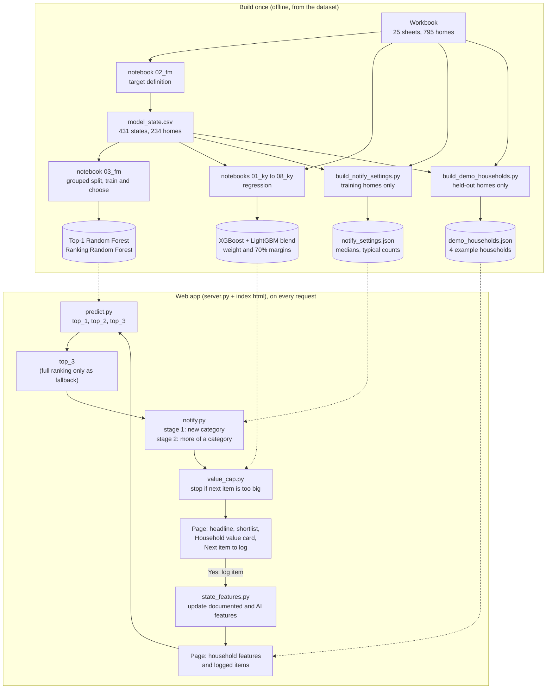

# myVal Next-Category Recommendation

Machine learning prototype developed for the myVal Capstone Project.

The objective of this project is to recommend the **next household-content category** that may be relevant for a customer to document, using the information already available within myVal.

The recommendation is sequential: as the customer adds more assets and the household state evolves, the model can generate a new recommendation.

The repository holds **four connected pieces**, described in order in the *Pipeline Overview* below: the next-category classifier (two Random Forests), the household contents-value regression (an XGBoost and LightGBM blend), a rule-based **next-item suggestion loop** that turns the classifier's output into one question at a time with a suggested value, and a small **web app** (`server.py`, `index.html`) that puts them together. The recommender files (`predict.py`, `models/*.joblib`, notebooks `01_fm` to `05_fm`) and the regression files are unchanged from GitHub, apart from kernel metadata in two notebooks. `server.py`, `index.html`, `tests/test_data.py`, the Makefile and this README were extended for the suggestion loop, and the files listed under *Next-Item Suggestion Loop* were added.

---

## Project Objective

The modelling task is defined as:

> Given the information already documented and analysed for a household, predict the next previously undocumented category that may be relevant for the customer to capture.

The model combines:

- documented household assets
- existing myVal AI-analysis outputs
- customer and household information
- property context
- optional property-video information

The system is designed as a recommendation tool, not as a claim that a category is definitely missing.

The second task is defined as:

> Given the items a household has documented so far, estimate the total contents value of the whole household and give a 70% interval around the estimate.

The regression excludes vehicles, because a vehicle is not a contents-insurance item and is worth many times an ordinary item.

---

## Pipeline Overview

### The whole pipeline in one picture



### The models and rules in the app

| # | Piece | Type | Input | Output | Used for |
|---|---|---|---|---|---|
| 1 | Top-1 Random Forest (`models/next_category_top1_random_forest.joblib`) | classifier | the household state (documented and AI features, customer, property, video) | one category, `top_1` | the fallback headline and the per-class results |
| 2 | Ranking Random Forest (`models/next_category_ranking_random_forest.joblib`) | classifier (regularised) | the same state | a probability for each of the 7 categories, so `top_2` and `top_3` | the shortlist bars and the suggestion |
| 3 | Value regression (`models/regression/`) | XGBoost + LightGBM blend (weight 0.28 / 0.72) on log value | the first 10, 20, 30 or 50 valued non-vehicle items plus five property fields | `estimate`, `lower_floored`, `upper` (70% interval) | the Household value card and the stopping limit |
| 4 | Suggested value and stage 2 (`models/notify_settings.json`) | medians and counts from the training households (no model) | the category | the suggested value, and which category is furthest below its typical count | the value on the card, and stage 2 |

The Random Forests and the regression are the models that were trained by the team and are used exactly as saved. The suggestion loop adds no trained model: the suggested value is a median, and why that was chosen over a machine-learning model or a clustering is the subject of the section *Why The Suggested Value Is A Median*, whose tables compare four models, five clustering methods and two rule-based groupings against the plain median and show that none was clearly better.

### Step by step

**Build once (in this order):**

1. Put the raw workbook in `data/raw/` (the `data/` folder is not tracked by git).
2. Run `notebooks/02_fm_target_definition.ipynb`. It reconstructs each household's history, defines the target (the next previously undocumented category) and writes `data/processed/model_state.csv`.
3. `notebooks/03_fm_modelling.ipynb` splits the households into train, validation and test (grouped by property), trains and compares the candidate models, and saves the two Random Forests in `models/`. `04_fm_inference.ipynb` checks the saved models and `my_val_capstone_01/modeling/predict.py`.
4. `notebooks/regression/01_ky` to `08_ky` build, tune, blend and audit the regression and write `models/regression/*.joblib` and `modeling/reg_predict_pipeline.py`. The saved models in the repository are used as they are (retraining does not reproduce them, see *Limitations*).
5. `python modeling/build_notify_settings.py` writes `models/notify_settings.json` (medians of first items and of all items, typical item counts) from the training households only.
6. `python modeling/build_demo_households.py` writes `models/demo_households.json`: the page's four example households, their real item names and values, the dropdown options and the category names.
7. Start the app: `uv run uvicorn server:app --reload` (or `python -m uvicorn server:app --port 8000`) and open `http://127.0.0.1:8000`.

**What happens on every request:**

1. The page loads the four example households from `/api/households` and sends the current household (features plus its logged items) to `POST /api/predict`.
2. `predict.py` runs both Random Forests and returns `top_1`, `top_2` and `top_3`.
3. `notify.py` reads `top_3` (and the full ranking from `ranking.py` only if none of the three can be suggested while another category is empty). **Stage 1** picks the first contents category with no item and suggests the first-item median. When every category has an item, **stage 2** picks the category furthest below its typical count and suggests the all-items median.
4. `value_cap.py` asks the regression for the household's estimated total (only with 10 or more valued items). If the next suggested value is larger than the estimate minus what is already logged, the suggestion is replaced by "Nothing more to suggest".
5. The page shows the three sections described below. When the customer answers **Yes**, `POST /api/log-item` adds the item (documented counts and totals, mean evidence rating, and the AI features kept in step) and the page asks `/api/predict` again, so the next question follows. **No** stops the loop.

### What the page shows

- **Four example buttons**, all real households that the recommender never trained on (validation or test): Just started (PRP-000059, 1 item), Typical household (PRP-000176, 7 items), Well documented (PRP-000588, 21 items) and Large inventory (PRP-000675, 80 items, chosen by hand). The first three are the real held-out states whose item count is closest to 1, 7 and 21, the sizes of the original page's three presets.
- **Three sections.** On the left, the *Household inventory*: each category with the real item names and values. In the middle, *Most likely next category to document*: the headline and the ranked shortlist (the ranking model's top 3 with its probabilities). On the right, *Household value* (the regression estimate with its 70% range, the total logged and a progress bar) above *Next item to log* (the question, an editable value, an optional item name, and the Yes and No buttons). Narrow screens stack the sections.
- **The headline follows the card.** When the card asks about a new category, the headline shows that same category. Otherwise (every category already has an item, or the stopping limit applies) it shows the Top-1 model's pick. No confidence is shown on the headline, because it would come from a different model than the bars.
- **The technical switch** (top right, off by default) shows the category codes, the "AI detected" counts, the documented value, replacement cost and evidence rating, and the four panels AI analysis, Property, Customer and Property video. Hidden fields are still sent to the recommender.
- **Every number on the page comes from the dataset.** Nothing a customer sees is typed by hand. The page reads the regression's smallest basket (10 items) and its interval level (70%) from the regression itself, and the holdout figure it quotes (the share of test states whose true next category was in the top 2) from the data, through the server. The only choices made by hand are the sizes of the first three example households (1, 7 and 21 items, the sizes of the original page's presets), the choice of the Large inventory household, the button names and the wording.

### Which script regenerates which file

| Script or notebook | Writes | Run it when |
|---|---|---|
| `notebooks/02_fm_target_definition.ipynb` | `data/processed/model_state.csv` | the workbook changes |
| `notebooks/03_fm_modelling.ipynb` | `models/*.joblib` (the two Random Forests) | you retrain the classifier |
| `notebooks/regression/01_ky` to `08_ky` | `data/processed/regression/`, `models/regression/`, `modeling/reg_predict_pipeline.py` | you retrain the regression |
| `modeling/build_notify_settings.py` | `models/notify_settings.json` | `model_state.csv` changes |
| `modeling/build_demo_households.py` | `models/demo_households.json` | `model_state.csv` or the workbook changes |
| `python -m nbconvert --execute --inplace notebooks/value/01_value_by_household_cluster.ipynb` | rewrites that notebook and `models/value_clusters/best_value_clusters.joblib` | you want to repeat the clustering test (needs the `origin/develop` branch of the repository) |
| `modeling/value_model_experiment.py`, `modeling/simulate_suggestion_loop.py` | nothing (they print results) | you want to repeat the evidence |

---

## Main Workflow

```text
Customer documents an asset
        ↓
myVal AI analyses the asset
        ↓
Household state is updated
        ↓
Next-category recommendation model
        ↓
Top-1 / Top-2 / Top-3 recommendations
```

A single property can generate multiple prediction opportunities as more assets are documented.

The regression follows the same household state:

```text
Household state at the prediction time
        ↓
Earliest 10 / 20 / 30 / 50 documented non-vehicle items (the basket)
        ↓
Household-value regression (XGBoost and LightGBM blend)
        ↓
Estimated household total with a 70% interval
        ↓
Five optional regression columns for the recommendation model
```

---

## Repository Structure

The project follows a Cookiecutter Data Science structure. The regression, the classifier and the suggestion loop each have their own files, and the files that existed before the regression and the suggestion loop were added stay in the folder roots.

```text
.
├── data/                                  (not tracked by git)
│   ├── raw/
│   │   └── myVal_Synthetic_Datasets_release_v2.xlsx
│   ├── processed/
│   │   ├── model_state.csv                (built by 02_fm_target_definition, also read by the regression)
│   │   ├── regression/                    (train, validation, test and unlisted tables)
│   │   └── classification/                (model_state_with_reg.csv, optional output of make regression_features)
│   └── interim/
│       └── regression/                    (sheet copies, property split, state diagnostics)
│
├── models/
│   ├── next_category_top1_random_forest.joblib
│   ├── next_category_ranking_random_forest.joblib
│   ├── notify_settings.json               (generated by modeling/build_notify_settings.py)
│   ├── demo_households.json               (generated by modeling/build_demo_households.py)
│   ├── regression/
│   │   ├── xgb_log_model.joblib
│   │   ├── lgbm_log_model.joblib
│   │   ├── final_hyperparameters.joblib
│   │   └── ensemble_weight_and_margins.joblib
│   └── value_clusters/
│       └── best_value_clusters.joblib     (record of the clustering test, not used by the app)
│
├── modeling/
│   ├── predict.py                         (a copy of my_val_capstone_01/modeling/predict.py; the app does not use it, and its model path points outside the project)
│   ├── reg_predict_pipeline.py            (regression production pipeline, written by 08_ky)
│   ├── build_notify_settings.py           (medians and typical counts, training households only)
│   ├── build_demo_households.py           (the page's example households, held-out only)
│   ├── splits.py                          (the grouped split, shared by the scripts)
│   ├── simulate_suggestion_loop.py        (replays the loop on held-out households)
│   └── value_model_experiment.py          (machine-learning models against the median)
│
├── my_val_capstone_01/
│   ├── config.py
│   ├── dataset.py, features.py, plots.py  (Cookiecutter template stubs, not used)
│   ├── modeling/
│   │   ├── train.py                       (template stub, not used)
│   │   ├── predict.py                     (recommendation inference, unchanged from GitHub)
│   │   ├── notify.py                      (stage 1 and stage 2 of the suggestion)
│   │   ├── state_features.py              (updates the household when an item is logged)
│   │   ├── settings.py                    (loads models/notify_settings.json)
│   │   ├── ranking.py                     (full ranking, fallback only)
│   │   └── value_cap.py                   (regression stopping limit)
│   └── regression/
│       ├── config.py
│       ├── dataset.py
│       ├── features.py
│       └── modeling/
│           ├── predict.py
│           └── train.py
│
├── notebooks/
│   ├── 01_fm_data_inventory.ipynb
│   ├── 02_fm_target_definition.ipynb
│   ├── 03_fm_modelling.ipynb
│   ├── 04_fm_inference.ipynb
│   ├── 05_fm_demo.ipynb                   (empty)
│   ├── catboost_info/                     (CatBoost training output, not used)
│   ├── regression/
│   │   ├── 01_ky_eda_dataset.ipynb
│   │   ├── 02_ky_data_preparation.ipynb
│   │   ├── 03_ky_modelling_xgboost_lightgbm.ipynb
│   │   ├── 04_ky_ensemble_and_intervals.ipynb
│   │   ├── 05_ky_test_evaluation.ipynb
│   │   ├── 06_ky_split_and_sampling_audit.ipynb
│   │   ├── 07_ky_prediction_table.ipynb
│   │   └── 08_ky_reg_prediction_pipeline.ipynb
│   └── value/
│       └── 01_value_by_household_cluster.ipynb
│
├── tests/
│   ├── test_data.py                       (recommender output and full ranking)
│   ├── test_notify.py                     (suggestion logic)
│   ├── test_state_features.py             (household update)
│   ├── test_demo_households.py            (the example households)
│   ├── test_value_cap.py                  (stopping limit)
│   ├── test_regression.py
│   └── regression_conftest.py             (not named conftest.py, so pytest does not load it)
│
├── reports/
│   └── NEW_WORK_REPORT.md                 (short report on the suggestion loop; your own presentation material also sits here)
│
├── docs/
│   ├── mkdocs.yml, README.md
│   └── docs/                              (index.md, getting-started.md, regression.md)
│
├── server.py, index.html                  (the web app)
├── tree.txt                               (a Windows directory listing, not used)
├── Makefile
├── pyproject.toml
├── uv.lock
└── README.md
```

The regression code is the subpackage `my_val_capstone_01/regression/`, so it is part of the same Python package as the inference code and the suggestion loop.

### Which folder belongs to which part

| Folder or file | Regression | Classification (next category) | Suggestion loop and web app | Both or shared |
| --- | --- | --- | --- | --- |
| `data/raw/` | | | | the source workbook |
| `data/processed/model_state.csv` | read to rebuild the split | built by `02_fm_target_definition` | read by the build scripts | shared input |
| `data/processed/regression/`, `data/interim/regression/` | modelling tables, sheet copies, split, diagnostics | | | |
| `models/*.joblib` in the root | | the Top-1 and ranking models | used by the app | |
| `models/regression/` | two models, hyperparameters, blend weight and margins | | used for the Household value card and the stopping limit | |
| `models/notify_settings.json`, `models/demo_households.json` | | | generated inputs of the app | |
| `models/value_clusters/` | | | record of the clustering test | |
| `notebooks/01_fm` to `05_fm` | | the team's classification notebooks (`05_fm_demo` is empty) | | |
| `notebooks/regression/` | `01_ky` to `08_ky` | | | |
| `notebooks/value/` | | | the clustering test | |
| `my_val_capstone_01/modeling/predict.py` | | inference | called by the app | |
| `my_val_capstone_01/modeling/` (other files) | | | the suggestion loop | |
| `my_val_capstone_01/regression/`, `modeling/reg_predict_pipeline.py` | the reusable regression code | | `value_cap.py` calls the pipeline | |
| `modeling/` (build, simulate, experiment, splits) | | | the suggestion loop | |
| `server.py`, `index.html` | | | the web app | |
| `tests/` | `test_regression.py` | `test_data.py` | the other test files | |
| `Makefile`, `pyproject.toml`, `uv.lock`, `docs/`, `reports/` | | | | shared |

The regression only reads `data/processed/model_state.csv` of the classification side. It does not change any classification file.

---

## Notebook Overview

### Classification notebooks (`notebooks/`)

These are the team's original classification notebooks. The regression and the suggestion loop do not change them (`01_fm` and `04_fm` differ from GitHub only in kernel metadata; `05_fm_demo.ipynb` is an empty file).

#### `01_fm_data_inventory.ipynb`

Initial exploration of the source workbook.

Main tasks:

- workbook and table inspection;
- key and relationship validation;
- category distribution analysis;
- temporal sequence exploration;
- AI-analysis and video coverage checks.

#### `02_fm_target_definition.ipynb`

Construction of the supervised learning target.

The target was defined as the **next previously undocumented category** for a property.

This notebook also:

- reconstructs historical household states;
- handles simultaneous category events;
- keeps the documented-asset features as of the prediction time (the AI, video, customer and property features have the limits listed under Data Leakage Prevention);
- combines asset, AI, customer, property and video information;
- creates the final processed modelling dataset.

Final processed dataset:

```text
431 prediction states
234 properties
60 columns
```

#### `03_fm_modelling.ipynb`

Model development and evaluation.

The dataset was split by `Property_ID` to ensure that historical states from the same household did not appear across train, validation and test partitions.

Models evaluated included:

- Majority-Class Baseline
- Logistic Regression
- Random Forest
- Tuned CatBoost
- Regularised CatBoost
- Regularised Random Forest

The notebook also includes:

- overfitting analysis;
- grouped cross-validation;
- hyperparameter tuning;
- AI-feature ablation;
- feature importance;
- permutation importance;
- final holdout evaluation.

#### `04_fm_inference.ipynb`

Validation of the persisted models and reusable inference function.

The inference pipeline returns:

- Top-1 recommended category;
- Top-2 ranked recommendations;
- Top-3 ranked recommendations;
- predicted probabilities.

Reusable inference logic is located in:

```text
my_val_capstone_01/modeling/predict.py
```

### Regression notebooks (`notebooks/regression/`)

The regression notebooks estimate the total contents value of a household from the first N documented items (N = 10, 20, 30 or 50), and they are run in the numbered order. Each notebook reads the files saved by the one before it.

#### `01_ky_eda_dataset.ipynb`

Exploratory analysis of the source workbook from the point of view of the household value.

Main tasks:

- data-quality checks of the four core tables (customers, customer profiles, properties and assets)
- households per customer and the structure of the properties table
- vehicles, which are examined separately because they are excluded from the target
- value of the contents of a home compared with property and customer attributes
- inspection of every tab in the workbook

#### `02_ky_data_preparation.ipynb`

Construction of the modelling table.

This notebook:

- converts the slow `.xlsx` sheets to parquet once, so that later runs reload them quickly
- builds the target, which is the total value of the non-vehicle items of a household, and the household features
- simulates a customer who has documented N items, with 5 random baskets per household and per N
- turns every basket into a row of 26 features
- applies the same grouped split by property as the classification model (70% train, 15% validation and 15% test, `GroupShuffleSplit` with seed 42)
- checks how much of the home each basket covers and compares the distribution of the total value across the three sets

Final data sets:

```text
1,840 rows from 159 properties
train: 81 properties and 1,030 rows
validation: 18 properties and 230 rows
test: 13 properties and 150 rows
unlisted: 47 properties and 430 rows
```

The households that are not in the classification states are kept in an unlisted set, which is not used for training, tuning or testing.

#### `03_ky_modelling_xgboost_lightgbm.ipynb`

Model development on the training set, with every choice made on the validation set.

The notebook includes:

- the reasoning for choosing the number of trees on the validation curve and not on the training data
- an XGBoost baseline and a LightGBM baseline without tuning
- an 80-candidate random search for each family, fitted on train and scored on validation
- tuned models fitted on all of train, with the number of trees chosen on the validation curve averaged over 8 seeds
- validation curves, validation metrics in dollars and the final hyperparameters

The target is modelled on the `log1p` scale and all metrics are converted back to dollars. The test set is not used in this notebook. The two models and the final hyperparameters are saved as joblib files in `models/regression/` (`xgb_log_model.joblib`, `lgbm_log_model.joblib` and `final_hyperparameters.joblib`); there is no CSV copy.

#### `04_ky_ensemble_and_intervals.ipynb`

Combination of the two models and construction of the 70% interval, using the validation set only.

The notebook:

- compares the two models and chooses the blend weight (0.28 for XGBoost and 0.72 for LightGBM)
- learns one interval margin for each N group (0.828, 0.511, 0.426 and 0.590)
- explains why the margins are not learned on the training set
- shows the success rate per N on the training rows and the validation rows side by side
- saves the frozen weight and margins as one dictionary in `models/regression/ensemble_weight_and_margins.joblib`, which notebooks 05, 06 and 07 and the inference code read

The interval on the validation set is in-sample, so it is a description of the fit and not a result.

#### `05_ky_test_evaluation.ipynb`

The only place where the test set is scored.

The notebook applies the frozen weight and margins to the test set and reports:

- the accuracy of the ensemble in dollars (MAE and WAPE)
- the success rate of the 70% interval for each N and overall
- the success rate at row level and at household level, with definitions and an example
- train, validation and test side by side

The result tables and figures are shown in the notebook. Nothing is tuned or changed after this notebook has been run.

#### `06_ky_split_and_sampling_audit.ipynb`

Audit of the differences between the success rates of the three sets.

The notebook examines:

- what is in each set and the bias and error by set
- which homes determine the validation margin
- the uncertainty of the margin itself, using a bootstrap
- the success rate of the test set under other random splits
- the uncertainty of the test success rate
- how far the success rate of each basket can be believed

It shows that the validation rate of about 70% is by construction, that the training rate is high because it is in-sample, and that the high test rate comes mostly from easier test households and a favourable draw of homes. A 31-household cross-fitted estimate gives a real rate of about 70%.

#### `07_ky_prediction_table.ipynb`

Creation of the prediction table of all baskets.

The notebook predicts every basket row of the four data sets and saves the estimate and the 70% interval, with a label of train, validation, test or unlisted. The interval lower bound is never below the documented value. The checks in this notebook cover consistency and labels only and do not compute accuracy. The table is saved as `data/processed/regression/regression_predictions_all_splits.csv`.

#### `08_ky_reg_prediction_pipeline.ipynb`

Creation of the production pipeline.

The notebook reads the saved models, the frozen blend weight and margins and the code in `my_val_capstone_01/regression/`, and writes the production file `modeling/reg_predict_pipeline.py`. The pipeline takes the documented items and the property details of one household and returns the estimate and its 70% interval. It only loads the joblib files in `models/regression/` and never trains or changes anything.

---

## Run Order

The regression reads one file of the classification side, so the notebooks are run in this order:

1. `notebooks/02_fm_target_definition.ipynb` creates `data/processed/model_state.csv` from the raw workbook.
2. `notebooks/regression/01_ky` to `07_ky` build and evaluate the regression, and `08_ky` writes the production pipeline `modeling/reg_predict_pipeline.py` (use `predict_from_items(items, property_info)` from it to get the estimate and the 70% interval of one household). Notebook `02_ky` reads `model_state.csv` to reproduce the classification split. Notebook `03_ky` saves the two models and the final hyperparameters, and notebook `04_ky` saves the blend weight and margins, all as joblib files in `models/regression/`. Notebooks `05_ky` to `08_ky` read those files and need `04_ky` to be run first.
3. The classification notebooks `notebooks/01_fm` to `04_fm` are run as described in their own section (`05_fm_demo` is an empty file). The regression is not needed for them.
4. The suggestion loop and the web app are built with `python modeling/build_notify_settings.py` and `python modeling/build_demo_households.py` (both need `model_state.csv`), then started with `uv run uvicorn server:app --reload`. See the *Pipeline Overview*.

The regression code can also be run from the project root:

```text
python -m my_val_capstone_01.regression.dataset
python -m my_val_capstone_01.regression.modeling.train
```

The same steps are available as Makefile rules (`make regression_dataset` and `make regression_train`). `python -m my_val_capstone_01.regression.features` (rule `make regression_features`) is optional: it adds the five regression columns to the recommendation states and writes `data/processed/classification/model_state_with_reg.csv`, which no notebook of this branch uses.

The data folder is not tracked by git, so the raw workbook has to be placed in `data/raw/` first.

---

## Data Leakage Prevention

Data leakage prevention was a key part of the modelling design.

The main controls were:

- the documented-asset features (item counts per category, documented value and replacement-cost totals, mean evidence rating) only use assets created by the prediction time, and the target category is never already documented in its state (0 of 431 states)
- future asset and category information is excluded from those features
- simultaneous category events are not artificially ordered
- preprocessing is fitted only on training data
- train, validation and test sets are grouped by `Property_ID`
- the final test set remained untouched during model selection and tuning

The grouped split produced:

```text
Train:       309 rows | 163 properties
Validation:   67 rows |  35 properties
Test:         55 rows |  36 properties
```

Property overlap between all partitions was zero.

**Known limits of this control.** Not every feature group is strictly point-in-time, and customers can appear in more than one partition:

- **AI features:** the AI analysis rows are not filtered by their own timestamp. Filtering them would change `ai_asset_count` in 175 of 431 states. Every asset is known at the prediction time, but its AI output may not exist yet.
- **Video features:** videos are summed over the whole property, whatever their date. 100 of the 118 video rows tied to the states were created after the state's prediction time.
- **Customer and property attributes** (for example `Tenure_Months`, `Property_Valuation_AUD`, occupation) are static snapshots, not values as of the prediction time.
- **Customers across partitions:** the split is by property, and 30 customers own more than one property. 11 customers appear in both train and validation, 5 in train and test, and 2 in validation and test. 7 of the 55 test states belong to a customer who is also in train.
- **Effect:** a review refitting the Random Forest without the video features, without the customer and property attributes, or with documented-asset features only gave accuracy of about 0.43 to 0.45, close to the full model, so the target does not appear to depend on these groups. These refits are a reviewer's check and are not part of the notebooks. The numbers in this README therefore describe a model whose AI, video, customer and property inputs are not strictly as of the prediction time.

The regression follows the same rules:

- the regression uses the same grouped split as the classification model, rebuilt from `model_state.csv` with the same code, so a household is never in different partitions in the two models
- the five regression columns of a state only use items documented by the prediction time
- no model is trained on the validation or test households, and the test set is scored in one notebook only
- the 53 training states with a regression estimate are in-sample, because the regression models were fitted on those households

---

## Modelling Results

The strongest Top-1 validation result came from the standard Random Forest.

However, the model showed substantial overfitting, so a regularised Random Forest was also evaluated for ranking recommendations.

### Final Holdout Results

**Top-1 Random Forest**

```text
Accuracy:    0.5091
Macro F1:    0.3223
Weighted F1: 0.4431
```

**Regularised Random Forest Ranking**

```text
Top-2 Accuracy: 0.7091
Top-3 Accuracy: 0.8364
```

These results suggest that the problem works particularly well as a **ranked recommendation task**, where the model provides several relevant category suggestions instead of relying only on one prediction.

These are the results of the team's original run without the regression columns. The results with the columns are reported in the section on the regression columns below.

---

## AI Contribution

An ablation experiment was performed to test whether the existing myVal AI outputs added predictive value.

With AI features:

```text
Validation Macro F1: 0.3676
```

Without AI features:

```text
Validation Macro F1: 0.3324
```

This suggests that the existing AI-analysis outputs provide useful additional information for the recommendation model.

---

## Feature Interpretation

Random Forest feature importance and validation permutation importance were used to understand which variables contributed most strongly to the predictions.

Important signals included:

- documented category composition
- number of assets already documented
- documented household value
- AI-detected category counts
- AI estimated asset values
- AI suggestion acceptance
- AI category agreement
- property valuation
- customer and household context
- selected video-derived information

The strongest validation permutation signal was the existing documented category profile.

The analysis was used for interpretation only and should not be treated as evidence of causal relationships.

---

## Final Model Selection

Two final models were retained because the project supports both a primary recommendation and ranked alternatives.

### Top-1 Recommendation

**Standard Random Forest**

Selected because it achieved the strongest Top-1 validation performance.

### Top-2 / Top-3 Ranking

**Regularised Random Forest**

Selected because it provided stronger ranking behaviour and reduced the generalisation gap.

### Household Value

**Blend of XGBoost and LightGBM**

Selected with a weight of 0.28 for XGBoost and 0.72 for LightGBM, which gave the lowest validation error. The weight is not sharply determined, because every weight between 0.12 and 0.56 is within $100 of the best.

---

## Per-Class Performance

Performance was not uniform across categories.

The strongest Top-1 performance was observed for:

- Electronics
- Furniture
- Other Items
- Appliances

The most difficult categories included:

- Clothings
- Jewellery and Personal Items
- Vehicles

These categories had substantially fewer observations, which limited the model's ability to generalise reliably.

---

## Inference

Two trained models are persisted in:

```text
models/
├── next_category_top1_random_forest.joblib
└── next_category_ranking_random_forest.joblib
```

Reusable inference logic is implemented in:

```text
my_val_capstone_01/modeling/predict.py
```

The prediction function returns:

```python
{
    "top_1": {
        "category": "...",
        "probability": ...
    },
    "top_2": [...],
    "top_3": [...]
}
```

An end-to-end inference test was successfully performed using an unseen holdout observation.

Example:

```text
Actual category: Other Items

Top-1:
Electronics

Top-2:
1. Electronics
2. Other Items

Top-3:
1. Electronics
2. Other Items
3. Clothings
```

This example illustrates the value of the ranked recommendation formulation: although the first recommendation was incorrect, the true next category appeared in the second position.

---

## Household Contents-Value Regression

### Method

A customer may have documented only part of a household. The regression predicts the total non-vehicle contents value of the whole household from a basket of the documented items.

- **Data:** the same workbook, with vehicles excluded and items without a value dropped. Only the 159 of 795 properties that own at least 10 valued items can be used, which gives 1,840 basket rows.
- **Baskets:** for every household, 10, 20, 30 and 50 items are drawn at random (5 draws each) and turned into 26 features, such as summary statistics of the values, the value per category and the household context.
- **Split:** train 81 properties (1,030 rows), validation 18 (230 rows), test 13 (150 rows), and 47 properties (430 rows) that never form a classification state are kept out.
- **Models:** XGBoost and LightGBM on the log of the total, with an 80-candidate random search on validation. The number of trees is chosen on the validation curve (20 for XGBoost and 70 for LightGBM).
- **Interval:** the two models are blended, and one margin per basket size is learned on the validation set (0.83 for N = 10, 0.51 for N = 20, 0.43 for N = 30 and 0.59 for N = 50). The interval is the estimate multiplied by one minus and one plus the margin, and its lower bound is never below the documented value.

### Results

Validation error of the models, in dollars:

```text
XGBoost baseline:   MAE 35,671
XGBoost tuned:      MAE 37,535
LightGBM baseline:  MAE 37,191
LightGBM tuned:     MAE 36,793
Blend (0.28 / 0.72): MAE 36,514
```

Test set, scored once with the frozen weight and margins:

```text
Ensemble:               MAE 19,544 | WAPE 35.4%
Household-level hit rate of the 70% interval: 87.6%
Row-level hit rate:                           86.0% (129 of 150 rows)
```

These numbers need to be read with care:

- the test set has only 13 households (5 at N = 30 and 3 at N = 50), so every figure is noisy
- the test homes are smaller than the validation homes (largest $138,593 against $360,420), which explains the lower error
- the margins come from only 18 validation households and two of them set most of the width, so the intervals are wide (on the test rows the median width of the 70% interval is about $61,600, and about $53,200 after the lower bound is raised to the documented value)
- over 2,000 random re-splits of the 31 validation and test households, the average hit rate was 69.1%, so the 70% target can be neither confirmed nor rejected with the current data

### Inference

Reusable inference logic is implemented in:

```text
my_val_capstone_01/regression/modeling/predict.py
```

`predict_household_value` receives one basket and returns the estimate, the two model predictions and the 70% interval. `checkpoint_for` returns the basket size that a number of documented items reaches.

---

## Regression Columns In The Classification Model

The regression can add five columns to the recommendation states (`build_regression_state_features` in `my_val_capstone_01/regression/features.py`). An estimate needs at least 10 documented items, so only a small share of the states (71 of 431) have one, and the other states carry -1.

An earlier experiment with these columns showed no consistent benefit for the recommendation model in a controlled check over 20 seeds. The original recommendation model therefore stays as it is, and the household-value regression is a separate estimate. The notebooks of that experiment are not part of this branch, and the recommender files are used as they are. The columns should be reconsidered when more household histories are available.

---

## Next-Item Suggestion Loop

The web page does not only rank categories. It turns the recommender's output into one question at a time:

> We think you have an item in Appliances worth about A$800 that you haven't logged yet. Would you like to log it?

The customer can change the value. **Yes** adds the item to the household, the recommender runs again on the new state, and the next question follows. **No** stops the loop (a link starts it again). The loop also stops when there is nothing left to suggest.

### How a suggestion is chosen

| Stage | When | Category comes from | Suggested value |
|---|---|---|---|
| 1. New category | Some contents category has no item yet | The recommender: the highest-probability category with no item | Median value of the **first item** people logged in that category |
| 2. More of a category | Every category has an item | A data rule: the category furthest below its typical item count | Median value of **all items** in that category |

The suggestion reads the recommender's `top_3` (the first three entries of the ranking) first. Only if none of the three can be suggested (all already documented, or Vehicles) while another contents category is still empty, it reads the full ranking instead (`my_val_capstone_01/modeling/ranking.py`, the same ranking model and sort as `predict.py`, which is unchanged). Without this fallback the loop jumped to stage 2 in 1 of 431 real states; with it, the suggestion equals the one from the full ranking in all 431. The recommender was trained to predict the next *undocumented* category, and there are only six contents categories, so stage 1 can ask at most about five times from a household with one item. Stage 2 takes over after that. It is a simple count rule, not the trained model. It could not be validated: no real household has all six contents categories documented (the most is five), so the situation it handles never occurs in the real states. Applied anyway to the 122 held-out states that are below typical somewhere, it picked a category the household later has more of in 70.5% of cases, against 52.6% for a random below-typical category and 76.2% for the category the household already has most of, so it does not beat a trivial baseline. Vehicles are never suggested: they are very rare (22 of 8,309 assets), the classifier did not learn them (F1 0.00 on the holdout) and their median value (A$19,500 over all 22 vehicles; the settings file, which uses the training households only, stores A$15,000, and neither is ever suggested) is far above any other category.

The numbers behind the suggestions come from the training households only (163 households, the split of `03_fm_modelling`):

| Category | Stage 1: first-item median | Examples behind it | Stage 2: all-items median | Typical item count |
|---|---|---|---|---|
| Appliances | A$800 | 57 | A$700 | 4 |
| Clothings | A$200 | 21 | A$37 | 1 |
| Electronics | A$599 | 47 | A$599 | 4 |
| Furniture | A$425 | 60 | A$399 | 4 |
| Jewellery and Personal Items | A$750 | 43 | A$500 | 2 |
| Other Items | A$250 | 69 | A$180 | 3 |

"Typical item count" is the median number of items among training households that have the category.

### What happens when an item is logged

Logging an item updates the features the recommender was trained on: the documented count of the category, the number of documented assets and categories, the documented value and replacement-cost totals, and the mean evidence rating (`my_val_capstone_01/modeling/state_features.py`). Adding a household's real assets one at a time to a real state reproduces the next real state exactly (`tests/test_state_features.py`, 40 real transitions).

The AI-analysis features (`ai_*`) cannot be rebuilt exactly for a new item, because it has not been through the AI. They are kept in step instead, assuming the AI would estimate the value the customer confirmed: the AI count of the category and `ai_asset_count` go up by one, and `ai_estimated_value_total`, `_mean` and `_max` are updated with that value. The two AI rates stay as they were. Left frozen, the number of documented items grows past the AI count after a few items, a gap the recommender never saw in training (documented minus AI is 0 to -2 there). On 51 real held-out transitions the recommender's top pick matched the one from the real next state in 88% of cases with frozen AI features and in 100% with them kept in step (small sample, and the real item value was used for the check). The recommender can still name a category the household already has, because nothing masks documented categories: in the replay the Top-1 model's pick was an already-documented category in 41% of steps with the AI features kept in step (51% when frozen), rising from 0% at the first step to most steps after five. This is why the page headline follows the card (the best category not yet documented) and uses the Top-1 pick only when there is no new-category suggestion. The 41% and 51% refer to the Top-1 pick, not to the page headline, and they were measured with a throwaway script that is not in the repository.

### How well does the loop work on real households?

`modeling/simulate_suggestion_loop.py` replays the loop on the 71 validation and test households, starting from each household's earliest state. The simulated customer says yes when the household really owns that category (or ends with more items in it), according to its full asset history.

| Result | Value |
|---|---|
| First suggestion accepted | 64.8% |
| Suggestions accepted before the first "no" | mean 1.37, median 1 |
| Households that said no immediately | 25 of 71 |
| Accepted new-category suggestions / "more of a category" suggestions | 77 / 20 |

The replay uses the stage logic on the recommender's `top_3` only: it has no full-ranking fallback and no stopping limit, so it describes a slightly simpler loop than the live app (the fallback changes the suggestion in 1 of 431 real states). Because the first "no" ends the loop, most loops stop early. The 64.8% depends on the definition of "yes" above, so it is not a measured accuracy of the recommender. Opt-in status (`Notification_Opt_In`) does not block the prompt.

### Stopping when the household is near its estimated total value

The household contents-value regression (the committed models in `models/regression/`, not retrained) can also end the loop. `my_val_capstone_01/modeling/value_cap.py` calls `predict_from_items` from `modeling/reg_predict_pipeline.py` on the household's logged items and computes

```text
headroom = estimate - value already logged        (never below 0)
```

If the next suggested value is larger than the headroom, the card is replaced by "Nothing more to suggest". For example, with an estimate of 28,500 and 28,000 already logged (in one go, or 20,000 earlier plus 8,000 through the loop), a suggestion worth more than 500 stops the loop, while one worth 500 or less is still offered.

- **Only when the regression can run.** It needs at least 10 valued, non-vehicle items and the five property fields. Otherwise, and on any error, there is no limit and the loop behaves as before. In the real states only 71 of 431 (16%) have 10 or more valued items, so for most households the limit never applies.
- **What counts as logged:** the sum of the valued, non-vehicle items. An item with no recorded value adds nothing.
- **The estimate moves in steps.** It is computed from the first 10, 20, 30 or 50 items, so items logged beyond the current step do not change it until the next step is reached.
- **The estimate is imprecise.** Its 70% interval is wide (about plus or minus 51% at 20 items), so stopping at the point estimate can end the loop early for some households.
- **How it is wired.** The page sends its list of logged items with each `/api/predict` request. The server checks the cap after the suggestion is chosen and returns the cap details as `value_cap`.
- **On the page:** a "Household value" card between the recommendation and the question shows the estimate, its 70% range, the total logged and a progress bar, and updates after every Yes. Before the household has 10 valued items it shows only the logged total.
- Covered by `tests/test_value_cap.py`.

### Files

| File | Purpose |
|---|---|
| `my_val_capstone_01/modeling/notify.py` | The two-stage suggestion logic |
| `my_val_capstone_01/modeling/ranking.py` | Full sorted ranking of all categories (same ranking model as `predict.py`), read only as a fallback when none of the top 3 can be suggested |
| `my_val_capstone_01/modeling/value_cap.py` | Stops the loop when the next suggestion would take the household past its regression-estimated total value |
| `my_val_capstone_01/modeling/state_features.py` | Feature update when an item is logged |
| `my_val_capstone_01/modeling/settings.py` | Loads `models/notify_settings.json` |
| `modeling/build_notify_settings.py` | Builds `models/notify_settings.json` from the dataset (training households only) |
| `modeling/build_demo_households.py` | Builds `models/demo_households.json`: the page's example households, item names, dropdown options and category names, all from the dataset |
| `modeling/simulate_suggestion_loop.py` | Replay of the loop on held-out households |
| `modeling/splits.py` | The grouped train / validation / test split, shared by the scripts |
| `modeling/value_model_experiment.py` | Machine-learning models against the median (Experiments 1 and 2 below) |
| `notebooks/value/01_value_by_household_cluster.ipynb` | The clustering test (the clustering table below) |
| `models/value_clusters/best_value_clusters.joblib` | The fitted best clustering, kept as a record, not used by the app |
| `index.html` | The page: four example households, three sections, the cards and the technical switch |
| `server.py` | `/api/predict` also returns the suggestion and the stopping-limit details; `/api/log-item` adds an item; `/api/households` serves the example households |

---

## Why The Suggested Value Is A Median, Not A Machine-Learning Model

The recommender is a machine-learning model, so it is fair to ask why the suggested *value* is not. We tested that directly. **No machine-learning model, clustering method or household grouping beat a plain median of past values**, and the median is easier to explain, audit and maintain. The tests are described below so the decision can be checked and repeated.

### The question

When the loop asks about a new category, what value should it suggest? The target is the value of the item the customer actually documented next: the value of the assets created at the first event of the target category (median if several), for the same prediction states as the classifier. The table of Experiment 1 below uses all 373 next-item rows, vehicles included. Without vehicles there are 364 rows, which is the population of the clustering test. The picture is the same (second table below): the median is best on mean error, median error and the share within ±50% and ±25%, and the Random Forest's log error is only marginally lower (1.245 against 1.251).

All scores use **grouped cross-validation by `Property_ID`** on the training and validation households only, so a household never sits in both the training and the test part of a fold. The test households were not used to compare methods. Errors are in Australian dollars, except *log error*, the mean absolute error on log(value), which is fairer for values that range from $15 to $250,000. *Within ±50%* is the share of suggestions between half and one-and-a-half times the true value. Mean error is dominated by a handful of very expensive items, which is why it is thousands of dollars while the median error is about $400.

### 1. Predicting the value with a model (the usual machine-learning approach)

Reproduce with `python modeling/value_model_experiment.py`.

**Experiment 1: the value of the next item, same states as the classifier (373 rows, vehicles included).** The models get the classifier's own features plus the next category.

| Method | Mean error | Median error | Log error | Within ±50% | Within ±25% |
|---|---|---|---|---|---|
| **Category median** | **$2,770** | **$402** | **1.260** | **30.3%** | **17.2%** |
| Random Forest | $2,763 | $472 | 1.269 | 29.0% | 14.5% |
| Gradient Boosting | $2,857 | $536 | 1.349 | 27.1% | 15.0% |
| Ridge regression | $3,015 | $731 | 1.589 | 20.4% | 9.9% |

**Experiment 1 without vehicles (364 rows, the rows the loop can suggest for).**

| Method | Mean error | Median error | Log error | Within ±50% | Within ±25% |
|---|---|---|---|---|---|
| **Category median** | **$1,728** | **$393** | 1.251 | **30.8%** | **17.6%** |
| Random Forest | $1,740 | $454 | **1.245** | 29.4% | 14.8% |
| Gradient Boosting | $1,825 | $519 | 1.331 | 27.5% | 15.1% |
| Ridge regression | $1,995 | $714 | 1.566 | 20.6% | 9.9% |

**Experiment 2: the value of any item, from its category and the household's static details (5,154 items, 198 households).** The same question with far more rows, using property, customer and profile fields.

| Method | Mean error | Median error | Log error | Within ±50% | Within ±25% |
|---|---|---|---|---|---|
| **Category median** | **$1,539** | **$400** | **1.288** | **27.2%** | **13.9%** |
| Ridge regression | $1,558 | $386 | 1.262 | 26.5% | 12.4% |
| LightGBM | $1,561 | $416 | 1.333 | 25.2% | 11.1% |
| Random Forest | $1,580 | $447 | 1.371 | 25.0% | 11.0% |

No model is clearly better than the median. Ridge has a slightly lower median error and log error in Experiment 2, but it is worse on mean error and on the share within ±50% and ±25%, and it is the worst method in Experiment 1. The reason is how much values vary *inside* a category, which the household details do not explain:

| Category | 25th percentile | Median | 75th percentile |
|---|---|---|---|
| Appliances | $200 | $650 | $1,350 |
| Clothings | $15 | $45 | $182 |
| Electronics | $250 | $600 | $1,400 |
| Furniture | $170 | $450 | $1,200 |
| Jewellery and Personal Items | $150 | $599 | $3,000 |
| Other Items | $43 | $175 | $400 |

### 2. Suggesting the median of "similar households" (clustering)

The idea: group similar households and suggest the median first-item value of the category inside the household's cluster, falling back to the overall median when a cluster has fewer than five examples of the category. This is in `notebooks/value/01_value_by_household_cluster.ipynb`. The notebook prints its results and saves one file, the fitted best clustering (KMeans, 2 clusters, all features), to `models/value_clusters/best_value_clusters.joblib` as a record of what was tested.

The notebook compares 92 clustering configurations: **KMeans, Gaussian mixture, Ward hierarchical** (on a PCA-reduced space), and **average-linkage hierarchical and DBSCAN on Gower distance**, each on four feature sets (household profile, documented state, a small wealth set, and all), with 2 to 8 clusters. It adds two baselines, two random-cluster controls and two rule-based groupings (98 configurations in all). Everything is fitted inside each cross-validation fold. The cross-validation is repeated three times with different fold assignments (364 rows).

| Method | Mean error | Median error | Log error | Within ±50% | Within ±25% |
|---|---|---|---|---|---|
| Median of all items (what the loop used before) | $1,733 | $372 | 1.331 | 31.2% | 15.8% |
| **Median of the first item (adopted)** | **$1,723** | **$406** | **1.246** | **31.5%** | **16.1%** |
| KMeans, all features, 2 clusters (best clustering) | $1,725 | $419 | 1.241 | 31.0% | 16.9% |
| DBSCAN, state features | $1,722 | $400 | 1.244 | 31.7% | 16.1% |
| Gower distance, average linkage, all features, 2 clusters | $1,723 | $403 | 1.245 | 31.1% | 16.4% |
| Ward hierarchical, state features, 2 clusters | $1,731 | $423 | 1.254 | 31.5% | 15.5% |
| Gaussian mixture, all features, 2 clusters | $1,727 | $409 | 1.254 | 31.2% | 16.8% |
| Frontend-style groups (Just started / Typical / Well documented) | $1,746 | $450 | 1.260 | 30.7% | 15.5% |
| Tercile groups of documented items | $1,748 | $435 | 1.259 | 30.9% | 15.8% |
| Control: random clusters (3 / 6) | $1,748 / $1,803 | $443 / $440 | 1.286 / 1.316 | 29.7% / 28.0% | 14.2% / 14.1% |

The best clustering is not distinguishable from the plain first-item median. A paired bootstrap that resamples households puts the difference in log error at -0.005 (95% interval -0.040 to +0.029). Random clusters are *worse* than no clusters, because splitting the data thins out each category. The best clusters simply separate "has documented a lot" from "just started", and their category medians disagree from one category to the next (Electronics is A$399 in one cluster and A$800 in the other), which is what noise in small cells looks like. DBSCAN mostly forms one large cluster, so it reproduces the baseline.

**Groups like the frontend presets.** Households were assigned to the nearest of the three original example households of the page (1, 7 and 21 documented items, read from the original page on GitHub; the page now has four example households taken from the dataset): Just started is 1 to 4 items (241 rows), Typical household is 5 to 14 (90 rows) and Well documented is 15 to 80 (33 rows). With so few rows in the last group, most of its categories fall back to the overall median, and the grouping scores slightly worse than no grouping.

### 3. Why the first item and not all items

The only change that helped is a statistical one. When a customer is asked about a *new* category, the right comparison is the first item people log there, not every item ever logged. People tend to log their valuable items first. The median first clothing item is A$200, against A$37 for all clothing items, and Jewellery moves from A$500 to A$750. Changing the median to the first-item median lowers the log error by 0.086 (paired 95% interval -0.138 to -0.033, resampling households), the one improvement that holds up.

95% margins from resampling households 1,000 times:

| Method | Log error | Mean error | Median error | Within ±50% |
|---|---|---|---|---|
| Median of all items | 1.331 (1.204 to 1.474) | $1,733 ($1,201 to $2,318) | $372 ($324 to $420) | 31.2% (27.0% to 35.8%) |
| Median of the first item | 1.246 (1.122 to 1.381) | $1,723 ($1,192 to $2,303) | $406 ($323 to $485) | 31.5% (27.2% to 36.0%) |
| KMeans, 2 clusters | 1.241 (1.120 to 1.372) | $1,725 ($1,196 to $2,299) | $419 ($372 to $500) | 31.0% (26.6% to 35.4%) |
| Frontend-style groups | 1.260 (1.142 to 1.389) | $1,746 ($1,224 to $2,308) | $450 ($383 to $528) | 30.7% (26.2% to 35.0%) |

The margins overlap almost completely, so differences between methods are small compared with the noise. The first-item median improves the log error, but not the dollar errors or the share within ±50%.

### Why a statistical method is the right choice here

1. **Nothing beat it.** Four machine-learning models, five clustering methods and two rule-based groupings (frontend-style and terciles) all landed within noise of the plain median or worse, under cross-validation that keeps households apart.
2. **The data cannot support a model.** There are 364 labelled next-item values (373 including vehicles) and the target is heavy-tailed (Clothings has a median of $200 but a maximum of $15,000). A model needs more signal than the household details carry; the spread inside a category is far larger than any difference between households.
3. **It is explainable and auditable.** "The typical value of the first item people log in this category, from 163 households" can be shown to a customer and checked by the client. The project proposal makes the same argument for rule-based logic: a rule built from category priors "remains easy to explain to customers and audit for the client, unlike a learned policy".
4. **It is only a starting point.** The customer edits the value, and in myVal the real value comes from the AI analysing a photo. A more complex model would add maintenance and the risk of drift for no measurable gain.
5. **It is cheap to keep correct.** `python modeling/build_notify_settings.py` rebuilds every number from the dataset. There is no model to retrain or version.

### Limits of this evidence

- The median itself is a weak predictor: only about 31% of suggestions land within ±50% of the true value. It is a prior, not a prediction of a specific item.
- Comparing about 100 configurations and keeping the best one is optimistic, and 364 rows is small. The conclusion rests on the fact that nothing was clearly better, not on small gaps.
- A one-time check on the 53 untouched test rows was mixed (log error 1.379 for all items, 1.312 for the first item, 1.349 for KMeans) and is too small to conclude anything.
- Item-level information would change this: the item's name, brand or photo is far more informative than the household. A value model that uses it, or the AI's own estimate from a photo, is the sensible next step if more accuracy is needed.
- More data could change the result for stage 2 or for rare categories. The experiments are cheap to rerun.

### Reproduce

Run these from the project's virtual environment (the notebook with `python -m nbconvert`, so it uses the same Python as the project):

```bash
python modeling/build_notify_settings.py
python modeling/value_model_experiment.py
python -m nbconvert --to notebook --execute --inplace notebooks/value/01_value_by_household_cluster.ipynb
python modeling/simulate_suggestion_loop.py
```

The notebook prints its results and saves a single file, `models/value_clusters/best_value_clusters.joblib`. Nothing from the notebook, that file or `value_model_experiment.py` is used by the web app: the suggested values read only `models/notify_settings.json`. The notebook reads the page's original presets with `git show origin/develop:index.html`, so it needs that branch, and running it with `--inplace` rewrites the notebook and the joblib file.

---

## Limitations

The application and dataset are still at an early stage.

The current modelling dataset contains a limited number of historical prediction opportunities, and some categories are underrepresented.

The models also showed noticeable overfitting, especially when model complexity increased.

For this reason, the current implementation should be considered a **technical proof of concept**, rather than a production-ready recommendation system.

Future improvements would benefit from:

- more household histories
- more real customer interaction data
- better representation of minority categories
- additional behavioural signals
- repeated retraining as the application grows

The regression has its own limitations:

- only 159 households have 10 or more valued items, and only 13 of them are in the test set
- the baskets are simulated by random draws, because real logs of partial documentation do not exist
- retraining does not reproduce the committed regression models: rerunning notebooks `02_ky` to `05_ky` with the pinned XGBoost 3.2.0 selected a different tuned XGBoost and a blend weight of 1.0 instead of 0.28 (test MAE $21,075 against $19,544), and two reruns agree with each other. The committed models therefore come from a run that cannot be recreated here and are used unchanged
- the margins are estimated on 18 households and are very uncertain, especially for N = 30 and N = 50
- the regression estimates are available for a small share of the classification states, and the estimates of the training states are in-sample

---

## Environment

The project uses:

- Python
- pandas
- scikit-learn
- CatBoost
- XGBoost (pinned to version 3.2.0)
- LightGBM
- pyarrow
- matplotlib
- Jupyter
- joblib
- FastAPI and uvicorn (the web app)
- uv

Dependencies are managed through:

```text
pyproject.toml
uv.lock
```

XGBoost is pinned so that the installed version matches the one the saved models were created with. Rerunning the regression notebooks with this version still selects a different XGBoost model than the saved one (see *Limitations*). After changing `pyproject.toml`, the lock file has to be regenerated with `uv lock`.

The whole test suite is run with `python -m pytest tests` or `make test` from the project root (32 tests; 30 pass and 2 skip without the generated prediction files and `RUN_SLOW_TESTS`). The regression tests alone are run with `python -m pytest tests/test_regression.py`. The test that compares the state features reads `data/processed/classification/model_state_with_reg.csv`, which is created by `python -m my_val_capstone_01.regression.features` and fails when that file is missing. The slow check of the modelling tables is included when the environment variable `RUN_SLOW_TESTS` is set to 1.

---

## Summary

This project demonstrates that myVal's historical household information and existing AI-analysis outputs can be combined to generate useful next-category recommendations.

The strongest results were obtained when the problem was treated as a ranked recommendation task.

The final ranking model placed the observed next category within the Top-2 recommendations in **70.91%** of unseen test cases and within the Top-3 recommendations in **83.64%**.

At the same time, the experiments exposed important limitations related to sample size, class imbalance and overfitting.

The current implementation should therefore be considered a machine learning proof of concept that establishes technical feasibility and provides a foundation for future improvement as more real customer behaviour becomes available.

The household contents-value regression adds a second capability. From the first 10, 20, 30 or 50 documented items, an XGBoost and LightGBM blend estimates the total contents value of a household and gives a 70% interval whose lower bound is never below the documented value. On the 13 test households, which were scored once with a weight and margins frozen on the validation set, the test error is $19,544 (WAPE 35.4%) and the interval contains the true value for 87.6% of the households (86.0% of the rows).

The audit in `notebooks/regression/06_ky_split_and_sampling_audit.ipynb` shows that this test rate should not be read as the expected rate. The test households are easier than the validation households and the draw of homes was favourable, so a cross-fitted estimate on 31 out-of-sample households gives a rate of about 70%, which matches the target of the interval. The saved regression models are used unchanged: rerunning the notebooks with the pinned XGBoost 3.2.0 does not reproduce them.

The two models can be connected through five regression columns (`features.py`). Adding them to the recommendation model did not give a consistent benefit in a controlled 20-seed check, so the original recommendation model remains the model to use and the regression is kept as a separate estimate. Both parts are proofs of concept, and the regression columns should be reconsidered when more household histories are available.
