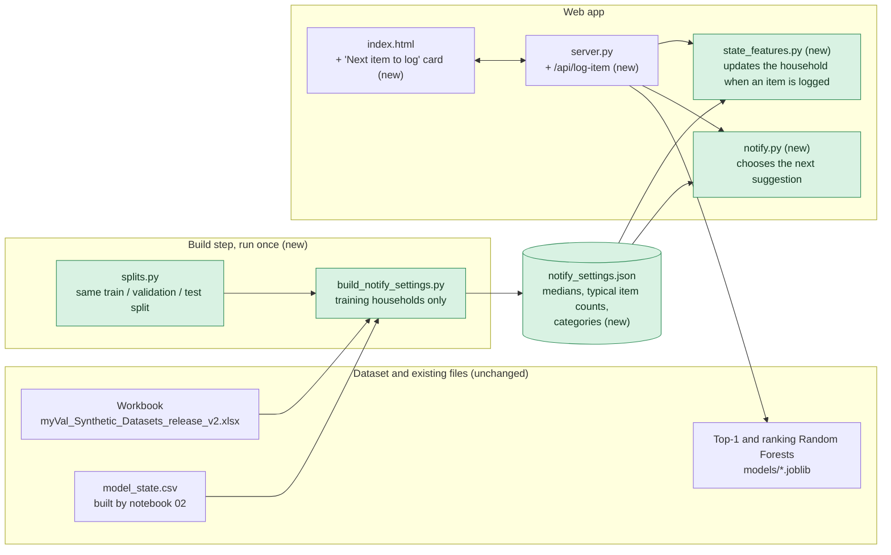
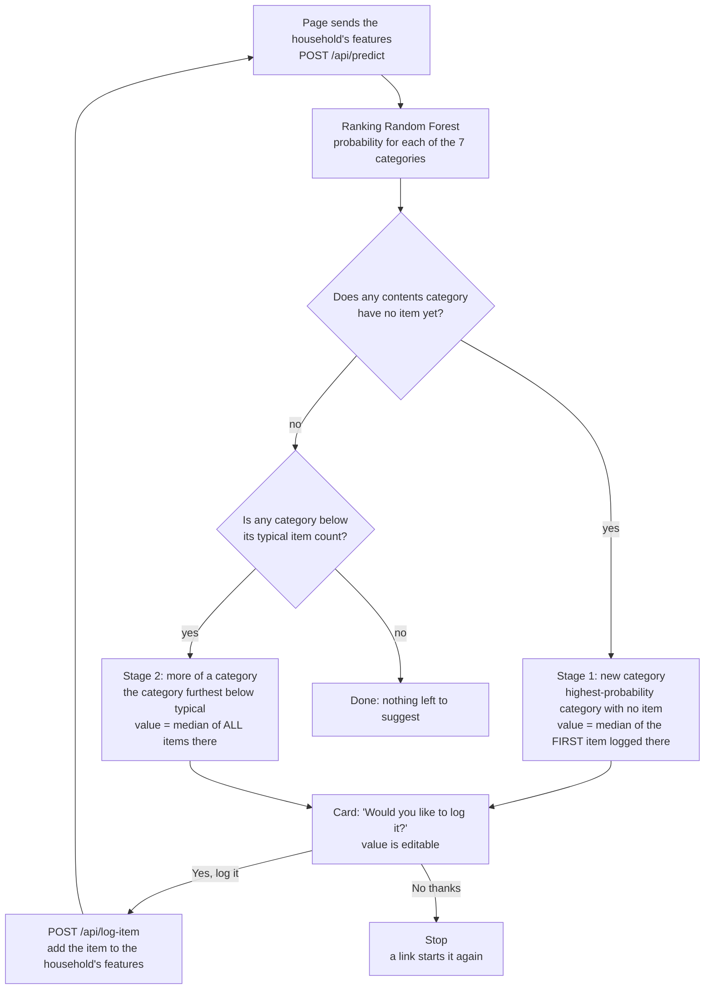

# What was added beyond the GitHub `develop` branch

Report date: 2026-10-10. "GitHub" here means `origin/develop`, the repo's default branch.

## In one paragraph

The web page used to rank the next category and stop there. It now also asks the customer one question at a time: "We think you have an item in Appliances worth about A$800 that you haven't logged yet. Would you like to log it?" A **Yes** adds the item, the recommender runs again on the new state, and the next question follows. A **No** stops the loop. The categories come from your existing Random Forest, the suggested values are medians computed from the dataset, and nothing in the repo's saved models was changed. We also tested whether a machine-learning model or a clustering of similar households could suggest better values than a plain median. None could, so the median stays, and the evidence is written up in the README.

## How it fits together

Everything in a green box below is new. The Random Forests, the dataset and the regression code are untouched.



## How one suggestion is chosen



## What is new

Compared with GitHub `develop`. Files marked "changed" already existed; the rest are new.

| Area | What was added | Files |
|---|---|---|
| **Web page** | A "Next item to log" card under the existing recommendation: the question, an editable value, Yes and No buttons. A switch in the top-right corner, off by default, shows or hides these: the category codes (CAT-001 and so on), the "AI detected" column, the value, replacement-cost and evidence-rating totals, and the four panels AI analysis, Property, Customer and Property video. The page now has three sections side by side (inventory, next category to document, and value plus next item). A "Household value" card shows the regression's estimate, the total logged and a progress bar, and updates after each Yes. The headline now follows the card (the best category not yet documented, titled "Most likely next category to document"), and the big confidence percentage was removed because it came from a different model than the bars. Everything else on the page is as on GitHub, including the top-3 bars. | `index.html` (changed) |
| **Web server** | `/api/predict` now also returns the suggestion. New endpoint `/api/log-item` adds an item to the household. | `server.py` (changed, +16 / -1) |
| **Recommender output** | Unchanged. The suggestion reads the recommender's existing `top_3`, and a full ranking only as a fallback. `predict.py` is identical to GitHub. | `my_val_capstone_01/modeling/ranking.py` (new, fallback only) |
| **Suggestion logic** | Chooses the next category and value in two stages (see the second flowchart). | `my_val_capstone_01/modeling/notify.py` |
| **Logging an item** | Recomputes the features the recommender was trained on (category counts, value and replacement-cost totals, evidence rating) when an item is added. | `my_val_capstone_01/modeling/state_features.py` |
| **Stopping limit** | The loop stops when the next suggestion is worth more than (regression estimate - value already logged). Needs 10+ valued items, otherwise no limit. Uses the committed regression models, unchanged. | `my_val_capstone_01/modeling/value_cap.py`, `tests/test_value_cap.py` (new); `server.py`, `index.html` (changed) |
| **Settings** | Loads the dataset-derived numbers. | `my_val_capstone_01/modeling/settings.py` |
| **Build step** | Builds every number the suggestions use from the dataset, from the **training households only**: first-item medians, all-items medians, typical item counts, categories. | `modeling/build_notify_settings.py`, `modeling/splits.py`, output `models/notify_settings.json` |
| **Replay of the loop** | Plays the loop on 71 real validation and test households to see how long it keeps going. | `modeling/simulate_suggestion_loop.py` |
| **Value experiments** | Tests whether Ridge, Random Forest, Gradient Boosting or LightGBM can predict an item's value better than the median. | `modeling/value_model_experiment.py` |
| **Clustering notebook** | Tests 92 clustering configurations plus rule-based groupings, with household-level error margins. Saves one file, the fitted best clustering, as a record. | `notebooks/value/01_value_by_household_cluster.ipynb`, `models/value_clusters/best_value_clusters.joblib` |
| **Tests** | Tests for the suggestion logic and for the feature update (including a replay on 40 real state-to-state transitions). The placeholder `assert False` was replaced with a real test, and one regression test now skips cleanly when its saved predictions are missing. | `tests/test_notify.py`, `tests/test_state_features.py` (new); `tests/test_data.py`, `tests/test_regression.py` (changed) |
| **README** | Two new sections: how the suggestion loop works, and why the suggested value is a median and not a machine-learning model, with the result tables and how to reproduce them. | `README.md` (changed, +175) |

## The decisions that matter, and why

- **Categories come from your recommender, unchanged.** The loop only re-runs your saved Random Forest on an updated household. No model was retrained.
- **The value is a median, not a model.** Four machine-learning models, five clustering methods and two groupings were tested with cross-validation that keeps each household in one fold. None was clearly better than a plain median. Values vary far more inside a category than between households, so there is no signal for a model to learn. The median is also easy to explain and audit.
- **First item, not all items, for a new category.** People log valuable things first. The median first clothing item is A$200, against A$37 for all clothing items. This lowers the log error by 0.086 (95% interval -0.138 to -0.033), the one improvement that held up.
- **Everything is computed from training households only,** so validation and test households never influence a suggestion.
- **Vehicles are never suggested.** They are very rare (22 of 8,309 assets), the classifier did not learn them, and their typical value is far above any other category.

## Results at a glance

| Question | Answer |
|---|---|
| How often is the first suggestion accepted (simulated, 71 held-out households)? | 64.8% |
| How many suggestions are accepted before the first "no"? | mean 1.37, median 1 |
| Did any model or clustering beat the median for the value? | No. All within noise or worse. |
| Does the median first item beat the median of all items? | Yes, on log error: -0.086 (-0.138 to -0.033). Dollar errors do not improve. |
| Do the repo's models still give the same results? | Yes. Holdout top-1 / top-2 / top-3 = 0.5091 / 0.7091 / 0.8364, as in your report. |
| Tests | 30 passed, 2 skipped (31 passed, 1 skipped with `RUN_SLOW_TESTS=1`) |

The 64.8% depends on how the simulated customer decides "yes" (the household really owns that category, according to its full history), so it is not a measured accuracy of the recommender.

## What is deliberately unchanged

The two saved Random Forests, the regression models and code (`my_val_capstone_01/regression/`, `modeling/reg_predict_pipeline.py`, `models/regression/`), the classification notebooks `01_fm` to `05_fm`, and the regression notebooks. The regression is not used by the page.

## Things to know

- **Stage 1 reads the recommender's `top_3` first**, and the full ranking (`ranking.py`) only if none of the three can be suggested while another category is empty. This makes the suggestion equal to the full-ranking design in all 431 real states.
- **Stage 2 is not the trained model.** After every category has an item (the recommender can ask about only about five new categories from one item), the loop asks for more in the category furthest below its typical item count. That is a simple data rule. It could not be validated: no real household has all six contents categories documented (the most is five), so the situation it handles never occurs in the real states. Applied anyway to the 122 held-out states that are below typical somewhere, it picked a category the household later has more of in 70.5% of cases, against 52.6% for a random below-typical category and 76.2% for the category the household already has most of, so it does not beat a trivial baseline.
- **Opt-in does not block the prompt.** `Notification_Opt_In` no longer stops the suggestion. It is still passed to the recommender as an input feature.
- **The AI-analysis features are kept in step** with a newly logged item (AI counts and AI value totals updated with the confirmed value, assuming the AI would agree). On 51 real held-out transitions the top pick then matches the one from the real next state in 100% of cases (88% when frozen). The recommender can still name an already-documented category (41% of replay steps), because nothing masks documented categories.
- **Most loops stop early,** because the first "no" ends the loop.
- **Everything on the page now comes from the dataset.** The four example households are real held-out states from `model_state.csv`: three are the ones closest to 1, 7 and 21 documented items (the sizes of the original presets), and a fourth, Large inventory (PRP-000675, a test household with 80 items), was chosen by hand, the dropdown options are the values found in the data, and the category names come from `base_categories`. `modeling/build_demo_households.py` writes `models/demo_households.json`; the server returns it at `/api/households`. Blank fields stay blank ("not recorded"), and the data has one more insurance type (`other`) than the page used to list.
- **The inventory lists the logged items by name** (real `Asset_Name` and value, "no value recorded" where the dataset has none) instead of + and - counters, so counts and totals always follow from the items. A newly logged item gets the name the customer types, or "<category> item".
- **Environment.** Your venv's command-line scripts (for example `jupyter`) still point at the old project folder, so they fail. Run tools with `python -m` from the venv, for example `python -m nbconvert`. Before this was noticed, an earlier run of the notebooks used the system Python.
- **Not part of this work.** Local changes to `notebooks/01_fm_data_inventory.ipynb` and `notebooks/04_fm_inference.ipynb`, and the files in `reports/`, were already there.
- **Nothing is committed.** All of this is local on the `front_dev` branch.

## How to run it

```bash
# one-off: build the numbers the suggestions use
python modeling/build_notify_settings.py

# start the page
python -m uvicorn server:app --port 8000

# evidence and evaluation
python modeling/value_model_experiment.py
python -m nbconvert --to notebook --execute --inplace notebooks/value/01_value_by_household_cluster.ipynb
python modeling/simulate_suggestion_loop.py

# tests
python -m pytest tests
```
